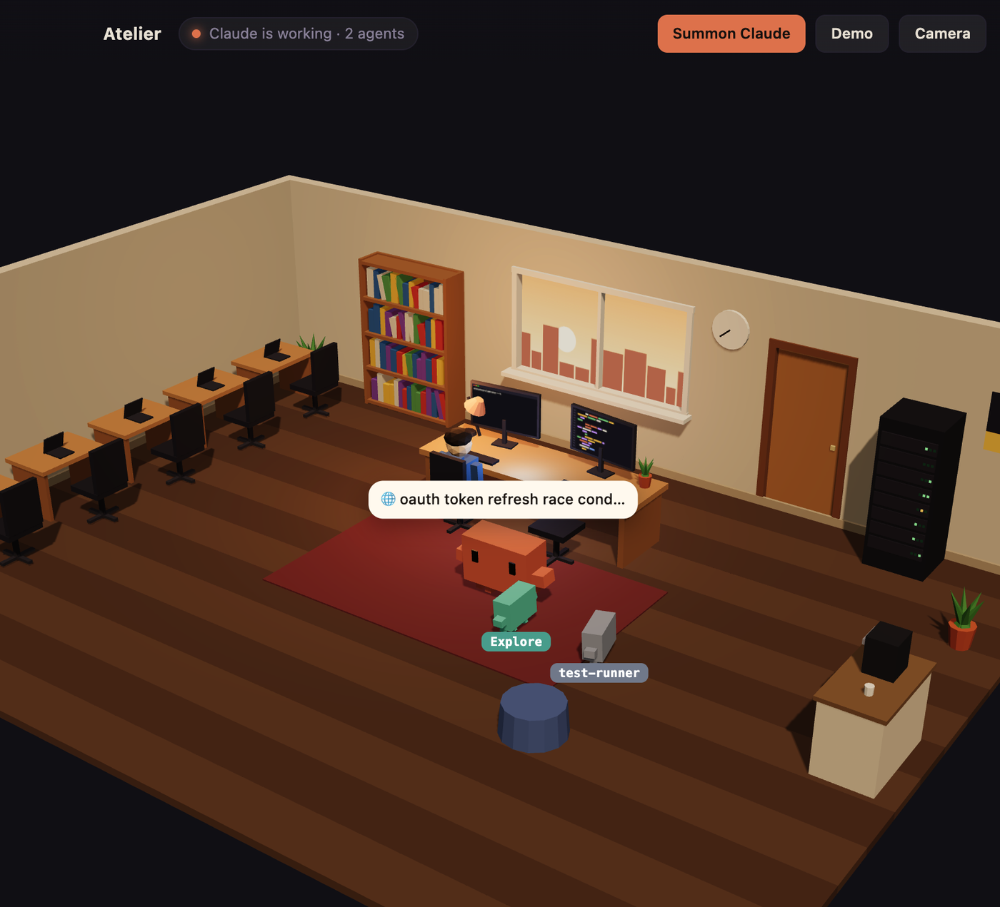

# Atelier

A cozy 3D workshop for [Claude Code](https://claude.com/claude-code). Your real terminal sits
on the right; on the left is a little room where you work at your desk. Type `claude` and
Claude walks in through the door, waves, and takes the seat next to you. From then on, every
step of the session plays out in the room: Claude types at its keyboard while editing files,
browses the bookshelf while searching the web, tinkers with the server rack while running
commands, and raises its hand when it needs your permission. Spin up subagents and small robots
arrive, take the spare desks, and report back when they are done.



## Features

- **A real terminal.** A full shell (via `node-pty` and xterm.js), not a mock. Everything you
  normally do in your terminal works as usual.
- **Driven by Claude Code hooks.** The room reacts to actual session events (tool calls,
  prompts, permission requests, subagents), so what you see is what Claude is doing.
- **Leaves your setup alone.** Hooks are only active inside Atelier's own terminal. Your
  `~/.claude/settings.json` is never touched.
- **Demo mode.** Press **Demo** to watch a scripted session without starting Claude.

## Requirements

- macOS with zsh (the default shell). The hook wiring relies on zsh.
- [Node.js](https://nodejs.org) 20 or newer
- [Claude Code](https://claude.com/claude-code) installed and signed in
- Xcode Command Line Tools (`xcode-select --install`), needed to compile `node-pty`

## Getting started

```sh
git clone https://github.com/atakankoprulu/atelier.git
cd atelier
npm install   # also compiles node-pty for Electron
npm start
```

Then type `claude` in the terminal on the right, or press **Summon Claude**.
**Camera** cycles through viewing angles, and you can drag the divider to resize the panels.

## How it works

- `main.js` starts your shell with `node-pty` and opens a small HTTP server that listens
  only on `127.0.0.1`.
- Inside Atelier's terminal, `claude` is wrapped so that it runs with `--settings`, pointing to
  a hooks file the app generates. Outside Atelier, nothing changes.
- Each hook calls `hooks/emit.sh`, which forwards the event to the app. It prints nothing and
  always exits successfully, so it can never interfere with Claude.
- `renderer/director.js` turns events into actions, and `renderer/scene.js` draws the room and
  the characters with three.js.

| Event | In the room |
|---|---|
| SessionStart | Claude walks in, waves, and sits down |
| UserPromptSubmit | You say your prompt out loud; Claude listens, then thinks |
| Edit / Write | Claude types at its keyboard |
| Read / Grep / Glob | Claude studies the screen |
| Bash | Claude tinkers with the server rack |
| WebSearch / WebFetch / Skill | Claude reads a book from the shelf |
| PermissionRequest / AskUserQuestion | Claude turns to you and raises its hand |
| SubagentStart / SubagentStop | A robot arrives and takes a desk, then reports back and leaves |
| Stop | Coffee break, then Claude leans back |
| SessionEnd | Claude says goodbye and leaves |

## License

[MIT](LICENSE)

Atelier is an independent fan project and is not affiliated with or endorsed by Anthropic.
